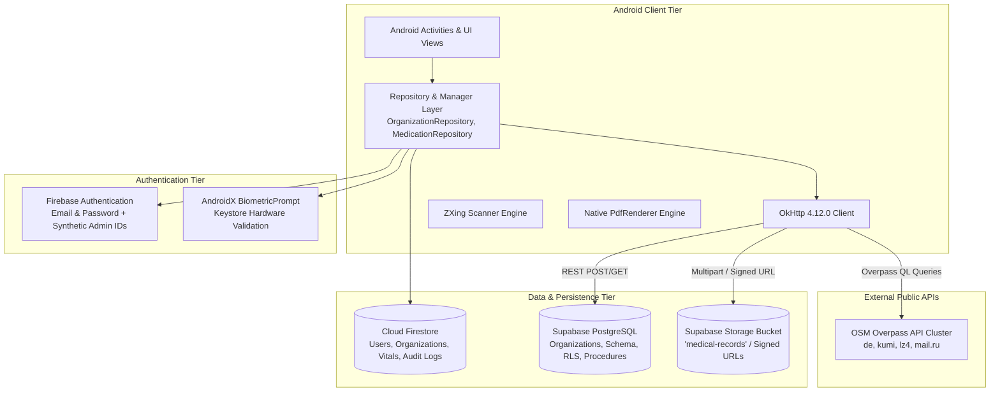
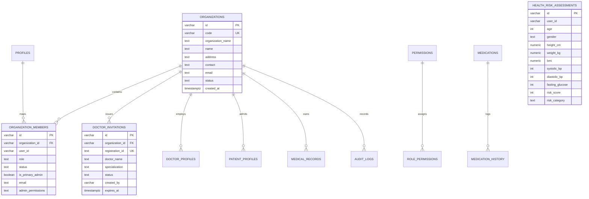

# MediLinkChain – Project Technology & Implementation Specification
**A Secure QR-Based Emergency Healthcare Data Access System**

*Document Generated: October 2026*  
*Workspace Root:* `c:\Users\Hemanth Reddy\AndroidStudioProjects\MediLinkChain2`  
*Primary Artifact:* `MEDILINKCHAIN_PROJECT_DETAILS.md`  

---

## 1. Project Overview

### 1.1 Full Project Title
**MediLinkChain – A Secure QR-Based Emergency Healthcare Data Access System Using Blockchain Technology**  
*Application Package:* `com.example.medilinkchain`  
*Primary Platform:* Native Android (Java / AndroidX / Material Design 3)  

### 1.2 Purpose of the Application
MediLinkChain is an enterprise-grade mobile healthcare and emergency data access system. It is designed to bridge the critical time gap in medical emergencies by granting emergency responders and treating physicians instant access to life-critical patient information—such as blood group, severe allergies, pre-existing chronic conditions, emergency contact numbers, and active medications—directly through a quick-response (QR) code interface, while maintaining strict role-based access control (RBAC), multi-hospital institutional boundaries, and granular patient privacy.

### 1.3 Main Problem It Solves
1. **The Emergency Data Gap:** In acute trauma, cardiac arrest, accidents, or unconscious patient encounters, first responders and emergency room physicians often have zero prior medical history for the patient. Administering contraindicated medications or transfusing incompatible blood types leads to preventable fatalities.
2. **Fragmented Health Records:** Patients frequently possess medical histories scattered across disparate physical papers, diagnostic laboratories, and independent hospitals. MediLinkChain consolidates diagnostic documents, lab reports, and prescriptions into a unified, encrypted digital vault.
3. **Institutional Boundary Enforcement:** Hospital administrators need an autonomous interface to manage their medical staff and admitted patients without compromising data isolation between independent medical centers.
4. **Offline / Low-Resource Emergency Navigation:** In emergency transit, users and ambulances need immediate awareness of surrounding accredited trauma and healthcare facilities without relying on proprietary, paid mapping subscriptions.

### 1.4 Main Features and User Roles

| User Role | Primary Responsibilities & Features | Source Evidence |
|:---|:---|:---|
| **Super Admin** | Central health authority; creates and lifecycle-manages hospital organizations; assigns primary hospital administrators; generates deterministic collision-resistant Admin IDs (`AD<YY>H<XXX>`); monitors global real-time telemetry across all hospital branches; views global audit logs. | [AdminDashboardActivity.java](file:///c:/Users/Hemanth%20Reddy/AndroidStudioProjects/MediLinkChain2/app/src/main/java/com/example/medilinkchain/AdminDashboardActivity.java), [HospitalManagementActivity.java](file:///c:/Users/Hemanth%20Reddy/AndroidStudioProjects/MediLinkChain2/app/src/main/java/com/example/medilinkchain/HospitalManagementActivity.java) |
| **Hospital Admin** | Facility-level administrator; scoped strictly to assigned `organizationId`; issues Doctor Invitations with unique registration codes (`DOC-<CODE>-<YEAR>-<SEQ>`); reviews doctor applications; approves or rejects doctor credentials; oversees hospital patients and facility-specific audit logs. | [DoctorManagementActivity.java](file:///c:/Users/Hemanth%20Reddy/AndroidStudioProjects/MediLinkChain2/app/src/main/java/com/example/medilinkchain/DoctorManagementActivity.java), [PatientManagementActivity.java](file:///c:/Users/Hemanth%20Reddy/AndroidStudioProjects/MediLinkChain2/app/src/main/java/com/example/medilinkchain/PatientManagementActivity.java) |
| **Doctor** | Clinical physician; scans patient emergency QR codes via device camera or gallery import; inspects patient emergency vitals and diagnostic records; manages outpatient consultation timing schedules; maintains doctor profile and license numbers; reviews admitted hospital patients. | [DoctorDashboardActivity.java](file:///c:/Users/Hemanth%20Reddy/AndroidStudioProjects/MediLinkChain2/app/src/main/java/com/example/medilinkchain/DoctorDashboardActivity.java), [DoctorScanActivity.java](file:///c:/Users/Hemanth%20Reddy/AndroidStudioProjects/MediLinkChain2/app/src/main/java/com/example/medilinkchain/DoctorScanActivity.java) |
| **Patient** | Individual user; generates emergency QR code; manages emergency contacts; uploads medical records and prescriptions; views uploaded files in-app via native PDF and zoomable image renderers; completes rule-based health assessments (BMI/vitals); tracks medication schedules with exact local notification alarms. | [DashboardActivity.java](file:///c:/Users/Hemanth%20Reddy/AndroidStudioProjects/MediLinkChain2/app/src/main/java/com/example/medilinkchain/DashboardActivity.java), [EmergencyActivity.java](file:///c:/Users/Hemanth%20Reddy/AndroidStudioProjects/MediLinkChain2/app/src/main/java/com/example/medilinkchain/EmergencyActivity.java) |

---

## 2. Frontend Technologies

### 2.1 Programming Languages Used
* **Java:** 100% of the active application source code is written in Java (configured with `sourceCompatibility = JavaVersion.VERSION_11` and `targetCompatibility = JavaVersion.VERSION_11` in [app/build.gradle.kts](file:///c:/Users/Hemanth%20Reddy/AndroidStudioProjects/MediLinkChain2/app/build.gradle.kts#L47-L50)).
* **XML:** Used for UI layout specifications, vector drawables, animation files, themes, and styles (66 layout files, 90+ drawable assets).
* **JavaScript:** A single client initialization stub file ([src/supabaseclient.js](file:///c:/Users/Hemanth%20Reddy/AndroidStudioProjects/MediLinkChain2/src/supabaseclient.js)) is present in the workspace root, initializing the Supabase JS client.

### 2.2 Android Development Framework and Tools
* **Android SDK Configuration:**
  * `compileSdk`: **35** (Android 15)
  * `minSdk`: **26** (Android 8.0 Oreo)
  * `targetSdk`: **35** (Android 15)
  * `versionCode`: **1**
  * `versionName`: `"1.0"`
  * `namespace`: `"com.example.medilinkchain"`
* **Build System:** Gradle 9.4.1 with Android Gradle Plugin (AGP) 9.2.1 and Foojay Toolchain Resolver 1.0.0.

### 2.3 Web Frontend Framework
* **Status:** **NOT VERIFIED / NOT PRESENT IN WORKSPACE.**
* *Investigation Findings:* There is no web frontend codebase (such as React, Next.js, Vite, Vue, or Angular) present in the workspace files. The workspace contains only the native Android project and a 10-line standalone JavaScript helper ([src/supabaseclient.js](file:///c:/Users/Hemanth%20Reddy/AndroidStudioProjects/MediLinkChain2/src/supabaseclient.js)).

### 2.4 UI Components, Layouts, Styling, and Navigation
* **Core Design System:** Google Material Design 3 (`com.google.android.material:material:1.10.0`), utilizing `MaterialCardView`, `MaterialButton`, `BottomNavigationView`, `TextInputLayout`, `TextInputEditText`, and custom shaped drawables.
* **Layout Architecture:**
  * Root containers built with `androidx.constraintlayout:constraintlayout:2.1.4` and `androidx.coordinatorlayout:widget.CoordinatorLayout`.
  * Multi-tier navigation using `androidx.drawerlayout:widget.DrawerLayout` for navigation drawers and `BottomNavigationView` for quick tab switching.
  * Lists and directories built using `androidx.recyclerview:widget.RecyclerView` with specialized view holder adapters.
* **Specialized Custom UI Components:**
  * **[ZoomableImageView.java](file:///c:/Users/Hemanth%20Reddy/AndroidStudioProjects/MediLinkChain2/app/src/main/java/com/example/medilinkchain/ZoomableImageView.java):** Custom Android `ImageView` supporting Matrix transformations, dual-pointer pinch-to-zoom, pan drag, and double-tap zoom for high-resolution medical document inspection.
  * **[CustomChartView.java](file:///c:/Users/Hemanth%20Reddy/AndroidStudioProjects/MediLinkChain2/app/src/main/java/com/example/medilinkchain/CustomChartView.java):** Custom view component for rendering vital sign trends and assessment history.
  * **[DocumentViewerActivity.java](file:///c:/Users/Hemanth%20Reddy/AndroidStudioProjects/MediLinkChain2/app/src/main/java/com/example/medilinkchain/DocumentViewerActivity.java):** Native Android `android.graphics.pdf.PdfRenderer` implementation that renders vector PDF documents page-by-page directly into Bitmaps on-device without launching external browsers.
* **Styling & Color System:**
  * Harmonized healthcare palette defined in [app/src/main/res/values/colors.xml](file:///c:/Users/Hemanth%20Reddy/AndroidStudioProjects/MediLinkChain2/app/src/main/res/values/colors.xml):
    * Primary Healthcare Blue: `#0D47A1` (`colorMedicalBlue`)
    * Light Background: `#F0F6FF` (`colorLightGrayBg`)
    * Surface Card Color: `#F4F7FC` (`surfaceColor`)
    * Role Badges: Patient (`#0EA5E9`), Doctor (`#10B981`), Super Admin (`#4F46E5`), Emergency SOS (`#EF4444`)

### 2.5 All Frontend Libraries and Dependencies

| Dependency Group & Name | Exact Version | Purpose in Application |
|:---|:---:|:---|
| `androidx.appcompat:appcompat` | `1.6.1` | Base backward-compatible Activity and Action Bar framework |
| `com.google.android.material:material` | `1.10.0` | Material 3 components, cards, bottom bars, dialogs |
| `androidx.activity:activity-ktx` | `1.8.0` | Modern Activity result contracts and lifecycle extensions |
| `androidx.constraintlayout:constraintlayout` | `2.1.4` | Responsive constraint-based view layouts |
| `androidx.biometric:biometric` | `1.1.0` | Hardware fingerprint and face unlock authentication |
| `com.journeyapps:zxing-android-embedded` | `4.3.0` | Camera barcode/QR scanner view and lifecycle management |
| `com.google.zxing:core` | `3.5.1` | Low-level QR matrix encoding and bitmap decoding algorithms |
| `org.osmdroid:osmdroid-android` | `6.1.20` | OpenStreetMap vector map rendering, tile caching, and pins |
| `com.google.android.gms:play-services-location`| `21.0.1` | FusedLocationProviderClient for high-accuracy GPS coordinates |
| `com.squareup.okhttp3:okhttp` | `4.12.0` | Asynchronous HTTP client for Supabase REST & Overpass OSM APIs |
| `org.json:json` | `20240303` | JSON parsing and object serialization |

---

## 3. Backend Technologies

### 3.1 Actual Backend Platform and Architecture
MediLinkChain uses a **Backend-as-a-Service (BaaS) and Direct-to-Cloud Client Architecture**. There is no standalone intermediary custom backend server (such as Node.js Express, Python Django/FastAPI, or Java Spring Boot) deployed in the workspace. Instead:
1. **Google Firebase Services:** Handles user authentication, security credential issuance, and NoSQL real-time document persistence.
2. **Supabase Cloud Services:** Provides a managed PostgreSQL 15+ relational database accessed over the PostgREST HTTP REST API, stored procedures in PL/pgSQL, and Supabase Object Storage buckets.
3. **OpenStreetMap Overpass API:** Public geospatial query engine providing healthcare facility nodes based on bounding coordinates.



### 3.2 Backend Programming Languages
* **Java:** Client-side business logic, data models, repository operations, network handlers, and data transformations.
* **PL/pgSQL:** Server-side stored functions, atomic sequence generators, and database triggers defined in [supabase_schema.sql](file:///c:/Users/Hemanth%20Reddy/AndroidStudioProjects/MediLinkChain2/supabase_schema.sql).

### 3.3 Authentication System
* **Primary Identity Provider:** Firebase Authentication (`com.google.firebase:firebase-auth`).
* **Synthetic Email Resolution:** MediLinkChain implements a custom synthetic email architecture in [LoginActivity.java](file:///c:/Users/Hemanth%20Reddy/AndroidStudioProjects/MediLinkChain2/app/src/main/java/com/example/medilinkchain/LoginActivity.java#L301-L325). When an administrator or doctor logs in using an assigned ID (e.g., `AD26H001` or `DOC-HOSP-2026-0001`), the client internally converts the input into an email address:
  * Admin ID $\rightarrow$ `ad26h001@admin.medilinkchain.org`
  * Doctor ID $\rightarrow$ `doc...001@doctor.medilinkchain.org`
* **Local Session Management:** [SessionManager.java](file:///c:/Users/Hemanth%20Reddy/AndroidStudioProjects/MediLinkChain2/app/src/main/java/com/example/medilinkchain/SessionManager.java) caches the authenticated user ID, role, assigned hospital ID, and account status in private Android `SharedPreferences` (`MediLinkSession`).

### 3.4 APIs, Backend Functions, and Business Logic
All API requests originate from the Android client repositories and helpers:
* **[SupabaseDbHelper.java](file:///c:/Users/Hemanth%20Reddy/AndroidStudioProjects/MediLinkChain2/app/src/main/java/com/example/medilinkchain/SupabaseDbHelper.java):** Dispatches asynchronous HTTP calls via `OkHttpClient` to `/rest/v1/health_risk_assessments` using `apikey` and `Authorization: Bearer <anon_key>` headers.
* **[SupabaseStorageHelper.java](file:///c:/Users/Hemanth%20Reddy/AndroidStudioProjects/MediLinkChain2/app/src/main/java/com/example/medilinkchain/SupabaseStorageHelper.java):** Manages binary stream uploads to `/storage/v1/object/medical-records/...` and issues signed URL generation requests to `/storage/v1/object/sign/...`.
* **[OrganizationRepository.java](file:///c:/Users/Hemanth%20Reddy/AndroidStudioProjects/MediLinkChain2/app/src/main/java/com/example/medilinkchain/OrganizationRepository.java):** Core repository containing 1,921 lines of orchestration logic for organization CRUD, doctor approvals, role verifications, and hospital statistics.
* **[OverpassHospitalService.java](file:///c:/Users/Hemanth%20Reddy/AndroidStudioProjects/MediLinkChain2/app/src/main/java/com/example/medilinkchain/OverpassHospitalService.java):** Dispatches Overpass QL bounding box queries with automatic failover across 4 public mirror endpoints.

---

## 4. Database and Storage

### 4.1 Actual Database Technology Used
The project employs a **dual-database architecture**:
1. **Google Cloud Firestore (NoSQL Document Store):** Used for low-latency operational data, user profiles, real-time snapshot listeners, patient emergency vital cards, and active reminders.
2. **Supabase PostgreSQL (Relational SQL Database):** Used for organizational hierarchy, relational memberships, audit logging, and SQL-backed risk assessments.

### 4.2 Cloud Firestore Document Collections

| Collection Name | Document Key | Important Fields | Purpose |
|:---|:---|:---|:---|
| `users` | Firebase UID | `email`, `fullName`, `name`, `role`, `status`, `patientId`, `bloodGroup`, `emergencyContactName`, `emergencyContactPhone`, `organizationId`, `hospitalName`, `profileComplete` | Primary user identity registry for Patients, Doctors, and Admins. |
| `organizations` | Auto-ID / Org ID | `code`, `organizationName`, `name`, `address`, `contact`, `email`, `status`, `createdAt` | Hospital facilities registry. |
| `organization_members`| Member ID (`member_<uid>`) | `userId`, `organizationId`, `role`, `status`, `isPrimaryAdmin`, `adminPermissions`, `email`, `fullName` | Granular hospital membership and role assignment. |
| `doctor_invitations` | Invitation ID | `registrationId`, `organizationId`, `doctorName`, `specialization`, `email`, `phone`, `status`, `createdBy`, `expiresAt` | Doctor registration invitation codes generated by Hospital Admins. |
| `doctor_profiles` | Doctor UID | `user_id`, `organization_id`, `doctorRegistrationId`, `medicalRegistrationNumber`, `hospitalName`, `specialization`, `verificationStatus`, `accountStatus` | Professional doctor licensing, timing, and credential records. |
| `users/{uid}/medical_records` | Record ID | `recordType`, `recordTitle`, `dateOfRecord`, `hospitalClinic`, `description`, `fileName`, `fileType`, `fileSize`, `fileUrl`, `storagePath`, `createdAt` | Metadata for uploaded lab reports, imaging, and clinical summaries. |
| `users/{uid}/prescriptions` | Prescription ID | `title`, `doctorName`, `hospitalName`, `prescriptionDate`, `filePath`, `fileType`, `fileSize`, `fileUrl`, `notes`, `createdAt` | Patient prescription records. |
| `users/{uid}/health_assessments`| Assessment ID | `age`, `gender`, `heightCm`, `weightKg`, `bmi`, `bmiCategory`, `systolicBp`, `diastolicBp`, `fastingBloodSugar`, `maintenanceCalories`, `assessmentDate` | Calculation-based vital assessments and dietary plans. |
| `users/{uid}/medications` | Medication ID | `medicineName`, `dosage`, `frequency`, `times`, `startDate`, `endDate`, `tabletQuantity`, `remainingTablets`, `refillThreshold`, `status` | Medication reminder schedules. |
| `users/{uid}/medication_history`| Log ID | `medicationId`, `medicineName`, `dosage`, `action` (`TAKEN`/`SKIPPED`/`REFILLED`), `quantityUsed`, `createdAt` | Patient medication adherence history. |
| `audit_logs` | Log ID | `organizationId`, `actorId`, `actorEmail`, `actorRole`, `action`, `targetType`, `targetId`, `description`, `createdAt` | System security audit trail. |

### 4.3 Supabase PostgreSQL Schema Tables
Defined in [supabase_schema.sql](file:///c:/Users/Hemanth%20Reddy/AndroidStudioProjects/MediLinkChain2/supabase_schema.sql):



* **Stored Procedures in PostgreSQL:**
  1. `generate_doctor_registration_id(p_org_id, p_doctor_name, ...)`: Computes sequence and mints unique registration IDs formatted as `DOC-<HOSP_CODE>-<YEAR>-<SEQ>`.
  2. `validate_doctor_invitation(p_registration_id)`: Atomically verifies validity, expiry, and active status of doctor invitation codes during registration.
  3. `assign_hospital_primary_admin(p_org_id, p_user_id, ...)`: Replaces existing hospital admins atomically and appends audit trail events.
  4. `check_super_admin_protection()`: Database trigger enforcing that at least one active Super Admin must always exist.
  5. `bootstrap_organization_and_super_admin(...)`: Initialization function provisioning default organization and Super Admin records.

### 4.4 File Storage Service and Buckets
* **Service:** Supabase Object Storage (`/storage/v1/object/`).
* **Bucket Name:** `medical-records` (Configured in [SupabaseConfig.java](file:///c:/Users/Hemanth%20Reddy/AndroidStudioProjects/MediLinkChain2/app/src/main/java/com/example/medilinkchain/SupabaseConfig.java#L44)).
* **Path Structure:** `${uid}/${featureName}/${uuid}.${extension}` (e.g., `user123/medical-records/uuid456.pdf`).
* **File Size Limit:** 10 MB maximum (`SupabaseConfig.MAX_FILE_SIZE_BYTES = 10L * 1024L * 1024L`).
* **Signed URLs:** Generated via `/storage/v1/object/sign/medical-records/...` with a 7-day validity duration (604,800 seconds).
* **Supported Media Formats:** PDF (`application/pdf`), JPEG (`image/jpeg`), and PNG (`image/png`).
* *Note on Firebase Storage:* Firebase Storage was previously removed/disabled (`// implementation("com.google.firebase:firebase-storage")` in [app/build.gradle.kts](file:///c:/Users/Hemanth%20Reddy/AndroidStudioProjects/MediLinkChain2/app/build.gradle.kts#L86)).

---

## 5. Authentication and User Roles

### 5.1 Patient Registration and Login
1. **Registration:** Patients sign up in [LoginActivity.java](file:///c:/Users/Hemanth%20Reddy/AndroidStudioProjects/MediLinkChain2/app/src/main/java/com/example/medilinkchain/LoginActivity.java#L398-L497) (in-place Register tab) or [SignupActivity.java](file:///c:/Users/Hemanth%20Reddy/AndroidStudioProjects/MediLinkChain2/app/src/main/java/com/example/medilinkchain/SignupActivity.java). The account is registered in Firebase Auth and initial patient profile documents are written to Firestore `users` and `organization_members` collections with `role: "PATIENT"`.
2. **Onboarding:** Newly created patient accounts have `profileComplete: false` and are routed to [CompleteProfileActivity.java](file:///c:/Users/Hemanth%20Reddy/AndroidStudioProjects/MediLinkChain2/app/src/main/java/com/example/medilinkchain/CompleteProfileActivity.java) to supply blood group, contact numbers, emergency contact information, and medical allergies.

### 5.2 Doctor Authentication and Onboarding
1. **Invitation Generation:** A Hospital Admin generates a unique registration ID (`DOC-<CODE>-<YEAR>-<SEQ>`) in [DoctorManagementActivity.java](file:///c:/Users/Hemanth%20Reddy/AndroidStudioProjects/MediLinkChain2/app/src/main/java/com/example/medilinkchain/DoctorManagementActivity.java).
2. **Application Submission:** The doctor registers using this invitation code, their medical council registration number, department, and contact details.
3. **Approval Gate:** The doctor profile is marked with `verificationStatus: "PENDING"`. When logging in, [LoginActivity.java](file:///c:/Users/Hemanth%20Reddy/AndroidStudioProjects/MediLinkChain2/app/src/main/java/com/example/medilinkchain/LoginActivity.java#L658-L669) inspects `verificationStatus`. If not `"APPROVED"`, access is denied and a dialog instructs the physician to await administrative approval.
4. **Mandatory First Login:** If marked `firstLogin: true`, the doctor is routed to [DoctorChangePasswordActivity.java](file:///c:/Users/Hemanth%20Reddy/AndroidStudioProjects/MediLinkChain2/app/src/main/java/com/example/medilinkchain/DoctorChangePasswordActivity.java) to set a private password before accessing clinical tools.

### 5.3 Hospital Admin Authentication
* **Provisioning:** Created by the Super Admin via [HospitalManagementActivity.java](file:///c:/Users/Hemanth%20Reddy/AndroidStudioProjects/MediLinkChain2/app/src/main/java/com/example/medilinkchain/HospitalManagementActivity.java) / [OrganizationRepository.java](file:///c:/Users/Hemanth%20Reddy/AndroidStudioProjects/MediLinkChain2/app/src/main/java/com/example/medilinkchain/OrganizationRepository.java).
* **Credentials:** The system auto-generates a deterministic Admin ID matching `AD<YY>H<XXX>` (e.g., `AD26H001`), creates a Firebase Auth account, and stores the user in `organization_members` with `isPrimaryAdmin: true` and `organizationId` locked to that specific facility.
* **Scope Restriction:** All hospital admin queries filter records strictly by `whereEqualTo("organizationId", sessionManager.getOrgId())`. Hospital admins cannot view or modify data belonging to other hospitals.

### 5.4 Super Admin Authentication
* **Hardcoded Bootstrap Identity:** Handled by [SuperAdminSetupHelper.java](file:///c:/Users/Hemanth%20Reddy/AndroidStudioProjects/MediLinkChain2/app/src/main/java/com/example/medilinkchain/SuperAdminSetupHelper.java).
* **Role Elevation:** Super Admin permissions (`ALL_PERMISSIONS`) are granted to designated master emails (`hemanthreddy046@gmail.com`, `superadmin@medilinkchain.org`, `admin@medilinkchain.org`).
* **Global Access & Take Control Mode:** The Super Admin can inspect system-wide hospital nodes and initiate "Take Control Mode" ([AdminDashboardActivity.java](file:///c:/Users/Hemanth%20Reddy/AndroidStudioProjects/MediLinkChain2/app/src/main/java/com/example/medilinkchain/AdminDashboardActivity.java#L79-L84)), simulating a specific Hospital Admin's view to resolve facility-specific issues.

### 5.5 Granular Permissions Matrix
Defined in [RolePermissionManager.java](file:///c:/Users/Hemanth%20Reddy/AndroidStudioProjects/MediLinkChain2/app/src/main/java/com/example/medilinkchain/RolePermissionManager.java):

| Permission Key | Super Admin | Hospital Admin | Doctor | Patient |
|:---|:---:|:---:|:---:|:---:|
| `HOSPITAL_CREATE` | Yes | No | No | No |
| `HOSPITAL_MANAGE` | Yes | No | No | No |
| `HOSPITAL_ADMIN_ASSIGN` | Yes | No | No | No |
| `ADMIN_CREATE` / `DISABLE` / `REMOVE` | Yes | No | No | No |
| `DOCTOR_INVITE` | Yes | Yes | No | No |
| `DOCTOR_VIEW` / `APPROVE` / `REJECT` | Yes | Yes | No | No |
| `DOCTOR_DISABLE` / `ENABLE` | Yes | Yes | No | No |
| `PATIENT_VIEW` / `ENABLE` / `DISABLE` | Yes | Yes | No | No |
| `SYSTEM_VIEW` | Yes | Yes | No | No |
| `AUDIT_VIEW` | Yes | Yes | No | No |
| `ORG_SETTINGS_MANAGE` | Yes | No | No | No |

---

## 6. QR Code Technology

### 6.1 Libraries Used
* **QR Generation:** ZXing Core (`com.google.zxing:core:3.5.1`) via `MultiFormatWriter` and `BitMatrix`.
* **QR Scanning:** ZXing Android Embedded (`com.journeyapps:zxing-android-embedded:4.3.0`) via `DecoratedBarcodeView` and `BarcodeCallback`, supplemented by ZXing Core's `MultiFormatReader`, `RGBLuminanceSource`, and `HybridBinarizer` for gallery image scanning.

### 6.2 Patient QR Code Generation Workflow
Implemented in [EmergencyActivity.java](file:///c:/Users/Hemanth%20Reddy/AndroidStudioProjects/MediLinkChain2/app/src/main/java/com/example/medilinkchain/EmergencyActivity.java#L54-L121):
1. **Identifier Resolution:** When the patient opens the Emergency Hub, the app retrieves the user's `patientId`. If missing, it generates a fallback identifier formatted as `MLC<UID_SUBSTRING_8>`.
2. **Payload Construction:** The payload is formatted as a standardized URI token:
   ```text
   PATIENT_ID:P26H0001
   ```
3. **Matrix Generation:** `MultiFormatWriter().encode(payload, BarcodeFormat.QR_CODE, 512, 512)` produces a boolean bit matrix.
4. **Bitmap Rendering:** The bit matrix is transformed into an ARGB 8888 Bitmap (`BLACK` for true, `WHITE` for false) and displayed on screen with high contrast.

### 6.3 Doctor QR Code Scanning Workflow
Implemented in [DoctorScanActivity.java](file:///c:/Users/Hemanth%20Reddy/AndroidStudioProjects/MediLinkChain2/app/src/main/java/com/example/medilinkchain/DoctorScanActivity.java#L142-L245):
1. **Camera Stream Acquisition:** `DecoratedBarcodeView` initializes the rear camera with continuous autofocus and an animated scanning laser guide. Flashlight can be toggled via `btnToggleFlashlight`.
2. **Gallery QR Import:** Alternatively, the doctor can tap "Import from Gallery" (`galleryLauncher`), which decodes bitmap pixels into an `RGBLuminanceSource` and scans for QR patterns using `HybridBinarizer`.
3. **Scan De-duplication & Validation:** An `AtomicBoolean isProcessingScan` prevents duplicate frame processing. The raw text is evaluated:
   * External web URLs (`http://`, `https://`, `www.`) are rejected immediately with an informative error modal.
   * The prefix `PATIENT_ID:` is extracted to isolate the patient code.
4. **Database Resolution & Access Authorization:**
   * Step 1: Queries Firestore `users` collection matching `whereEqualTo("patientId", targetId)`.
   * Step 2: If not found, attempts lookup by Firestore Document ID (Firebase UID).
   * Step 3: If not found, attempts lookup by `whereEqualTo("email", targetId)`.
   * Step 4: Verifies the doctor's active status and routes to [PatientDetailsActivity.java](file:///c:/Users/Hemanth%20Reddy/AndroidStudioProjects/MediLinkChain2/app/src/main/java/com/example/medilinkchain/PatientDetailsActivity.java), unlocking emergency vitals and authorized clinical files.

---

## 7. Blockchain Technology

### 7.1 Implementation Status
* **Status:** **NOT IMPLEMENTED / NOT VERIFIED IN SOURCE CODE.**

### 7.2 Detailed Technical Findings & Codebase Audit
1. **No Smart Contracts:** A comprehensive repository search across all directories reveals no Solidity (`.sol`), Vyper (`.vy`), or EVM bytecode files.
2. **No Web3 / Blockchain Libraries:** Neither `app/build.gradle.kts` nor `gradle/libs.versions.toml` includes Web3 libraries (e.g., `web3j`, `ethers`, `bitcoinj`, `hyperledger-fabric-sdk`, or `solana-web3`).
3. **No Blockchain RPC Nodes:** No RPC endpoint URLs (e.g., Infura, Alchemy, QuickNode, Ganache, or private Ethereum/Polygon nodes) are present in `SupabaseConfig.java`, `local.properties`, or application constants.
4. **No Cryptographic Block Ledger:** There are no classes or algorithms that build chained SHA-256 block structures, Merkle trees, or consensus verification logic in the Android Java code.
5. **Conclusion:** While the project title includes *"Using Blockchain Technology"* and previous conceptual reports envisioned SHA-256 block ledger hashing for uploaded medical files, **no working blockchain implementation exists in the current source code**. File integrity is currently managed by Supabase Object Storage checksums and Firestore audit logs.

---

## 8. Other Libraries and Integrations

### 8.1 Maps and Nearby Hospital Services
* **OpenStreetMap (osmdroid):** `org.osmdroid:osmdroid-android:6.1.20` provides the interactive map in [HospitalActivity.java](file:///c:/Users/Hemanth%20Reddy/AndroidStudioProjects/MediLinkChain2/app/src/main/java/com/example/medilinkchain/HospitalActivity.java).
* **Location Services:** `com.google.android.gms:play-services-location:21.0.1` (`FusedLocationProviderClient`) obtains high-accuracy user coordinates.
* **Overpass API Engine:** [OverpassHospitalService.java](file:///c:/Users/Hemanth%20Reddy/AndroidStudioProjects/MediLinkChain2/app/src/main/java/com/example/medilinkchain/OverpassHospitalService.java) queries OpenStreetMap hospital nodes asynchronously with automatic radius expansion (5 km $\rightarrow$ 12 km $\rightarrow$ 25 km) across 4 failover endpoints (`overpass-api.de`, `overpass.kumi.systems`, `lz4.overpass-api.de`, `maps.mail.ru`).
* **Offline Fallback Facilities:** If GPS is disabled, location permissions are denied, or Overpass API times out, `loadFallbackHospitals()` automatically injects verified accredited emergency trauma centers (e.g., Apollo, AIIMS, Fortis, KIMS, Care, Max) with pre-verified phone numbers and emergency calling buttons.
* **Directions Intent:** Tapping "Directions" launches external navigation via geo intents (`google.navigation:q=lat,lon` / `geo:lat,lon`), requiring no proprietary Google Maps API key.

### 8.2 AI Clinician and Diagnostic Analysis
* **Status:** **NOT IMPLEMENTED / NOT VERIFIED.**
* *Investigation Findings:* [ReportAnalysisResultActivity.java](file:///c:/Users/Hemanth%20Reddy/AndroidStudioProjects/MediLinkChain2/app/src/main/java/com/example/medilinkchain/ReportAnalysisResultActivity.java) exists in the package but is an **empty 0-byte file**. There are no external AI SDKs (such as OpenAI API, Google Gemini SDK, Anthropic Claude API, or LangChain) imported or integrated into the application.

### 8.3 Health Assessment and BMI Calculations
Implemented in [HealthAssessmentEngine.java](file:///c:/Users/Hemanth%20Reddy/AndroidStudioProjects/MediLinkChain2/app/src/main/java/com/example/medilinkchain/HealthAssessmentEngine.java) and [HealthRiskCalculator.java](file:///c:/Users/Hemanth%20Reddy/AndroidStudioProjects/MediLinkChain2/app/src/main/java/com/example/medilinkchain/HealthRiskCalculator.java):
* **Deterministic Rule-Based Logic:** Operates without AI or external network calls.
* **BMI Computation:**
  $$\text{BMI} = \frac{\text{Weight (kg)}}{(\text{Height (m)})^2}$$
  * Underweight: $< 18.5$
  * Normal Weight: $18.5 - 24.9$
  * Overweight: $25.0 - 29.9$
  * Obesity: $\ge 30.0$
* **Calorie Estimation (Mifflin-St Jeor Equation):**
  * Female: $\text{BMR} = 10 \times \text{weight} + 6.25 \times \text{height} - 5 \times \text{age} - 161$
  * Male: $\text{BMR} = 10 \times \text{weight} + 6.25 \times \text{height} - 5 \times \text{age} + 5$
  * Daily Maintenance: Multiplied by activity factor (Sedentary: 1.2, Lightly Active: 1.375, Moderately Active: 1.55, Very Active: 1.725).
* **Clinical Vitals Screening:** Classifies Blood Pressure stages (Normal, Elevated, Stage 1, Stage 2, Hypertensive Crisis) and Fasting Glucose (Normal, Prediabetes, Diabetes Indicator). Both the form and result screens include mandatory clinical disclaimers.

### 8.4 In-App PDF and Document Viewing
* **Native PDF Vector Rendering:** [DocumentViewerActivity.java](file:///c:/Users/Hemanth%20Reddy/AndroidStudioProjects/MediLinkChain2/app/src/main/java/com/example/medilinkchain/DocumentViewerActivity.java) downloads files to local cache via `OkHttpClient` and uses `android.graphics.pdf.PdfRenderer` with `ParcelFileDescriptor` to render PDF pages locally into full-resolution Bitmaps.
* **Pinch-to-Zoom Image Viewing:** [ZoomableImageView.java](file:///c:/Users/Hemanth%20Reddy/AndroidStudioProjects/MediLinkChain2/app/src/main/java/com/example/medilinkchain/ZoomableImageView.java) implements matrix transformations, smooth scaling boundaries, and dual-tap zoom for both images and rendered PDF pages.
* **Native Download Manager:** Provides an explicit download action dispatching requests to Android's system `DownloadManager` for permanent device storage.

### 8.5 Biometric Authentication
* **Library:** `androidx.biometric:biometric:1.1.0`.
* **Implementation:** [SettingsActivity.java](file:///c:/Users/Hemanth%20Reddy/AndroidStudioProjects/MediLinkChain2/app/src/main/java/com/example/medilinkchain/SettingsActivity.java#L225-L285) integrates `BiometricManager` to verify hardware availability and user enrollment (`BIOMETRIC_STRONG | DEVICE_CREDENTIAL`), prompting the user via `BiometricPrompt` before toggling biometric login sessions.

### 8.6 Medicine Reminders and Notifications
* **Notification Channels:** [MedicineAlarmManager.java](file:///c:/Users/Hemanth%20Reddy/AndroidStudioProjects/MediLinkChain2/app/src/main/java/com/example/medilinkchain/MedicineAlarmManager.java) configures two Android notification channels:
  1. `medication_reminders_channel` (`IMPORTANCE_HIGH` with vibration and audio)
  2. `medication_refills_channel` (`IMPORTANCE_DEFAULT`)
* **Exact System Alarms:** Uses Android's native `AlarmManager.setExactAndAllowWhileIdle()` to fire exact dose reminders in the device's local timezone.
* **Broadcast Receivers:**
  * [MedicineAlarmReceiver.java](file:///c:/Users/Hemanth%20Reddy/AndroidStudioProjects/MediLinkChain2/app/src/main/java/com/example/medilinkchain/MedicineAlarmReceiver.java): Catches alarm events, triggers notifications with actionable buttons ("Take Medicine", "Skip"), and decrements remaining pill counts.
  * [MedicineBootReceiver.java](file:///c:/Users/Hemanth%20Reddy/AndroidStudioProjects/MediLinkChain2/app/src/main/java/com/example/medilinkchain/MedicineBootReceiver.java): Catches `android.intent.action.BOOT_COMPLETED`, `MY_PACKAGE_REPLACED`, and `QUICKBOOT_POWERON` to automatically restore all scheduled alarms following a phone reboot.

---

## 9. Application Architecture

### 9.1 Overall System Flow
```
User / Device
     │
     ▼
[UI View / Activity] ◄─── User Interaction (Login, Form, QR Scan, Map)
     │
     ▼
[Repository / Manager Layer] (OrganizationRepository, SessionManager, RolePermissionManager)
     │
     ├────────────────────────┬────────────────────────┬────────────────────────┐
     ▼                        ▼                        ▼                        ▼
[Firebase Auth]        [Cloud Firestore]      [Supabase REST API]     [OSM Overpass API]
• User token           • Document CRUD        • PostgreSQL Tables     • Geospatial Queries
• Synthetic admin IDs  • Snapshot listeners   • Storage Buckets       • Hospital Nodes
• Session integrity    • Real-time updates    • Signed URLs           • Failover Mirrors
     │                        │                        │                        │
     └────────────────────────┴────────────────────────┴────────────────────────┘
                                      │
                                      ▼
                        [Data Parsed / Validated]
                                      │
                                      ▼
             [UI Updated: Dashboard / Record Details / Map Pins]
```

### 9.2 Android Application Architecture
* **Pattern:** Model-View-Presenter (MVP) and Clean Repository Pattern.
* **Separation of Concerns:**
  * **View Layer:** 84 Activity and View classes handling input, Android lifecycle, and UI animations.
  * **Repository Layer:** `OrganizationRepository.java`, `MedicationRepository.java`, `PrescriptionRepository.java`, `HealthAssessmentRepository.java` isolating Firebase Firestore and Supabase REST logic from UI components.
  * **Network & Helper Layer:** `SupabaseDbHelper.java`, `SupabaseStorageHelper.java`, `OverpassHospitalService.java`, `AuditLogManager.java` managing background executor threads (`Executors.newCachedThreadPool()`) and posting results to the main thread via `Handler(Looper.getMainLooper())`.
  * **Model Layer:** POJO data models implementing clean getters, setters, and document mapping.

---

## 10. Project Files and Folder Structure

### 10.1 Complete Source Code Catalog (`app/src/main/java/com/example/medilinkchain/`)

#### Authentication, Onboarding & Settings
| File Name | Lines | Purpose |
|:---|:---:|:---|
| `GetStartedActivity.java` | 80 | Splash and landing activity; checks Firebase session and auto-routes users. |
| `LoginActivity.java` | 727 | Unified login and register tabs; synthetic admin ID mapping; backend role resolution. |
| `SignupActivity.java` | 243 | Dedicated patient registration activity with input validation. |
| `CompleteProfileActivity.java` | 236 | Onboarding screen collecting blood group, emergency contacts, and vital medical history. |
| `ProfileActivity.java` | 164 | Patient profile view displaying medical demographics and contact details. |
| `EditProfileActivity.java` | 278 | Profile editor allowing patients to update allergies, vitals, and emergency numbers. |
| `SettingsActivity.java` | 405 | 7-item settings manager: Edit Profile, Change Password, Biometric Login, Policies, Version, Logout. |
| `SessionManager.java` | 160 | SharedPreferences session helper managing role, status, hospital codes, and cached login flags. |
| `RolePermissionManager.java` | 134 | Constants and authorization helper methods enforcing granular RBAC permissions. |
| `SuperAdminSetupHelper.java` | 179 | One-time idempotent bootstrap provisioning the default Super Admin account in Firebase. |

#### Super Admin & Hospital Administration
| File Name | Lines | Purpose |
|:---|:---:|:---|
| `AdminDashboardActivity.java` | 469 | Central administrative dashboard with role gating, real-time statistics, and Take Control mode. |
| `HospitalManagementActivity.java` | 382 | Super Admin interface to register, edit, activate, and disable hospital institutions. |
| `AdminManagementActivity.java` | 375 | Super Admin portal managing hospital administrators and generating `AD26Hxxx` Admin IDs. |
| `SuperAdminUserManagementActivity.java` | 389 | Super Admin directory to inspect and moderate all registered users and doctors across hospitals. |
| `DoctorManagementActivity.java` | 818 | Hospital Admin portal to generate doctor invitation IDs, review applications, and approve/reject doctors. |
| `PatientManagementActivity.java` | 255 | Facility-scoped patient directory allowing administrators to inspect hospital patients. |
| `OrganizationSettingsActivity.java` | 110 | Administrative screen to view and update facility details, email, and contact numbers. |
| `SystemMonitoringActivity.java` | 112 | Real-time system monitoring interface displaying active institutions, doctors, and records. |
| `AuditLogActivity.java` | 238 | Security audit log viewer rendering administrative intervention trails with search and filtering. |
| `AuditLogManager.java` | 137 | Central static service dispatching audit events asynchronously to Firestore and Supabase. |

#### Doctor Clinical Workflow
| File Name | Lines | Purpose |
|:---|:---:|:---|
| `DoctorActivity.java` | 73 | Base wrapper activity for doctor operations. |
| `DoctorDashboardActivity.java` | 165 | Doctor portal implementing the 4 core clinical modules: Scan QR, Profile, Timing, Hospital Patients. |
| `DoctorScanActivity.java` | 471 | Real-time ZXing barcode scanner and gallery QR decoder with duplicate suppression and validation. |
| `DoctorProfileActivity.java` | 158 | Profile editor for doctor's specialization, medical registration number, and hospital name. |
| `DoctorTimingActivity.java` | 187 | Outpatient consultation scheduler allowing doctors to configure weekly consultation hours. |
| `DoctorHospitalPatientsActivity.java` | 215 | Directory of admitted hospital patients under the doctor's facility. |
| `DoctorChangePasswordActivity.java` | 267 | First-login password change screen enforcing password resets for newly approved doctors. |
| `DoctorVerificationStatusActivity.java` | 125 | Status screen informing pending doctors of application review status. |
| `PatientDetailsActivity.java` | 174 | Clinical inspector displaying unlocked emergency medical records after scanning a patient's QR code. |

#### Patient Dashboard, Records & Viewer
| File Name | Lines | Purpose |
|:---|:---:|:---|
| `DashboardActivity.java` | 243 | Patient home dashboard featuring quick action cards and navigation drawers. |
| `EmergencyActivity.java` | 122 | Emergency hub generating patient emergency QR codes and providing one-tap emergency calling. |
| `MedicalRecordActivity.java` | 401 | Document uploader sending medical files to Supabase Storage and metadata to Firestore. |
| `ViewRecordsActivity.java` | 469 | Categorized records ledger (Prescription, Lab Report, Imaging) with search and filters. |
| `RecordDetailsActivity.java` | 482 | Record inspector showing file metadata, preview buttons, and deletion actions. |
| `DocumentViewerActivity.java` | 473 | Native vector PDF renderer (`PdfRenderer`) and zoomable document viewer with download action. |
| `ZoomableImageView.java` | 252 | Custom matrix pinch-to-zoom and pan `ImageView` for viewing images and PDF pages. |
| `ReportAnalysisResultActivity.java` | 0 | *Empty stub file (0 bytes).* Planned for AI report analysis. |

#### Health Assessments & Vitals
| File Name | Lines | Purpose |
|:---|:---:|:---|
| `HealthAssessmentActivity.java` | 362 | Clinical vitals input form (BP, fasting sugar, height, weight, age) with clear medical disclaimers. |
| `HealthAssessmentEngine.java` | 301 | Deterministic calculation engine: BMI, BMR (Mifflin-St Jeor), daily calories, BP/sugar stages. |
| `HealthAssessmentResultActivity.java` | 188 | Results screen displaying computed BMI, daily calorie plans, vitals classification, and disclaimers. |
| `HealthAssessmentHistoryActivity.java` | 189 | Historical list view of past health assessments. |
| `HealthRiskAssessmentActivity.java` | 305 | Lifestyle and cardiovascular risk assessment questionnaire. |
| `HealthRiskCalculator.java` | 206 | Scoring calculator evaluating lifestyle factors, smoking, alcohol, and physical activity. |
| `HealthRiskResultActivity.java` | 231 | Results screen showing lifestyle health risk index and recommendations. |
| `HealthRiskHistoryActivity.java` | 192 | History view for past lifestyle health risk screenings. |
| `CustomChartView.java` | 111 | Custom view drawing graphical assessment score trends. |

#### Medicine Reminders & Prescriptions
| File Name | Lines | Purpose |
|:---|:---:|:---|
| `MedicineDashboardActivity.java` | 383 | Medicine management dashboard showing today's doses, pill counts, and reminder toggles. |
| `AddEditMedicineActivity.java` | 409 | Form to add or edit medications, dosages, multi-dose daily times, and refill thresholds. |
| `MedicineAlarmManager.java` | 235 | Schedules exact system alarms via Android `AlarmManager` and initializes notification channels. |
| `MedicineAlarmReceiver.java` | 218 | `BroadcastReceiver` catching fired medicine alarms and generating actionable notifications. |
| `MedicineBootReceiver.java` | 35 | `BroadcastReceiver` restoring scheduled alarms upon device reboot (`BOOT_COMPLETED`). |
| `PrescriptionListActivity.java` | 175 | Patient prescription list showing active medications and attached prescription documents. |
| `AddPrescriptionActivity.java` | 300 | Clinical interface for entering doctor prescriptions, hospital details, and dates. |

#### Maps & Hospital Discovery
| File Name | Lines | Purpose |
|:---|:---:|:---|
| `HospitalActivity.java` | 776 | Interactive OpenStreetMap (`osmdroid`) showing nearby healthcare facilities with filters and directions. |
| `OverpassHospitalService.java` | 344 | OkHttp client querying OpenStreetMap Overpass API nodes with automatic radius expansion. |

#### Repositories, Helpers & Configuration
| File Name | Lines | Purpose |
|:---|:---:|:---|
| `OrganizationRepository.java` | 1,920 | Master repository for organizations, doctor invitations, admin delegation, and statistics. |
| `HealthAssessmentRepository.java` | 182 | Data access layer for reading/writing health assessments to Firestore. |
| `MedicationRepository.java` | 498 | Data access layer for medication schedules, adherence logs, and pill count updates. |
| `PrescriptionRepository.java` | 328 | Data access layer for prescription document records. |
| `SupabaseConfig.java` | 55 | Central configuration wrapping Supabase REST URL, Anon key, and storage bucket settings. |
| `SupabaseDbHelper.java` | 194 | OkHttp REST client executing queries against Supabase PostgreSQL tables. |
| `SupabaseStorageHelper.java` | 377 | OkHttp multipart file uploader and signed URL generator for Supabase Storage buckets. |

#### Data Models & Adapters
| Category | File Names |
|:---|:---|
| **Data Models (13 files)** | `AuditLogModel.java`, `DoctorInvitationModel.java`, `DoctorProfileModel.java`, `EmergencyContact.java`, `HealthAssessmentModel.java`, `HealthRiskAssessmentModel.java`, `Hospital.java`, `MedicationHistoryModel.java`, `MedicationModel.java`, `OrganizationMemberModel.java`, `OrganizationModel.java`, `OsmHospital.java`, `PatientProfileModel.java`, `PrescriptionModel.java` |
| **Adapters (10 files)** | `ContactsAdapter.java`, `HealthAssessmentAdapter.java`, `HealthRiskHistoryAdapter.java`, `HospitalsAdapter.java`, `MedicationAdapter.java`, `MedicationHistoryAdapter.java`, `NearbyHospitalAdapter.java`, `PrescriptionAdapter.java` |

---

## 11. Dependencies and Versions

### 11.1 Version Catalog (`gradle/libs.versions.toml`)
```toml
[versions]
agp = "9.2.1"
junit = "4.13.2"
junitVersion = "1.1.5"
espressoCore = "3.5.1"
appcompat = "1.6.1"
material = "1.10.0"
activityKtx = "1.8.0"
constraintlayout = "2.1.4"

[libraries]
junit = { group = "junit", name = "junit", version.ref = "junit" }
ext-junit = { group = "androidx.test.ext", name = "junit", version.ref = "junitVersion" }
espresso-core = { group = "androidx.test.espresso", name = "espresso-core", version.ref = "espressoCore" }
appcompat = { group = "androidx.appcompat", name = "appcompat", version.ref = "appcompat" }
material = { group = "com.google.android.material", name = "material", version.ref = "material" }
activity-ktx = { group = "androidx.activity", name = "activity-ktx", version.ref = "activityKtx" }
constraintlayout = { group = "androidx.constraintlayout", name = "constraintlayout", version.ref = "constraintlayout" }

[plugins]
android-application = { id = "com.android.application", version.ref = "agp" }
```

### 11.2 Root Build Configuration (`build.gradle.kts`)
* `com.android.application`: `9.2.1`
* `com.google.gms.google-services`: `4.4.2`
* `org.gradle.toolchains.foojay-resolver-convention`: `1.0.0`

### 11.3 Application Dependencies (`app/build.gradle.kts`)
* **AndroidX & Material:**
  * `androidx.activity:activity-ktx`: `1.8.0`
  * `androidx.appcompat:appcompat`: `1.6.1`
  * `androidx.constraintlayout:constraintlayout`: `2.1.4`
  * `com.google.android.material:material`: `1.10.0`
  * `androidx.biometric:biometric`: `1.1.0`
* **Firebase:**
  * `com.google.firebase:firebase-bom`: `33.5.1`
  * `com.google.firebase:firebase-auth`: *(managed by BOM 33.5.1)*
  * `com.google.firebase:firebase-firestore`: *(managed by BOM 33.5.1)*
  * *Note: `firebase-storage` is commented out.*
* **Networking & JSON:**
  * `com.squareup.okhttp3:okhttp`: `4.12.0`
  * `org.json:json`: `20240303`
* **QR & Barcodes:**
  * `com.journeyapps:zxing-android-embedded`: `4.3.0`
  * `com.google.zxing:core`: `3.5.1`
* **Geospatial & Maps:**
  * `com.google.android.gms:play-services-location`: `21.0.1`
  * `org.osmdroid:osmdroid-android`: `6.1.20`
* **Testing:**
  * `junit:junit`: `4.13.2`
  * `androidx.test.ext:junit`: `1.1.5`
  * `androidx.test.espresso:espresso-core`: `3.5.1`

---

## 12. Configuration and Development Tools

### 12.1 Environment and Build Tools
* **Android Studio:** Android Studio Ladybug / Jellyfish / Hedgehog.
* **Java Development Kit (JDK):** JDK 11 / JDK 17 (JBR bundled with Android Studio at `C:\Program Files\Android\Android Studio\jbr`).
* **Gradle Wrapper:** Gradle **9.4.1** (`https://services.gradle.org/distributions/gradle-9.4.1-bin.zip`).
* **Android SDK:**
  * Compile SDK: `35`
  * Min SDK: `26`
  * Target SDK: `35`

### 12.2 Environment Variables & Local Configuration
Required variables in [local.properties](file:///c:/Users/Hemanth%20Reddy/AndroidStudioProjects/MediLinkChain2/local.properties) (contains placeholders, never check secrets into git):
```properties
## Android SDK Path
sdk.dir=C\:\\Users\\<Username>\\AppData\\Local\\Android\\Sdk

## Supabase REST API & Storage Bucket Credentials (Placeholders)
supabase.url=https://<your-supabase-project-id>.supabase.co
supabase.publishable.key=sb_publishable_<your_anon_key_here>
SUPABASE_URL=https://<your-supabase-project-id>.supabase.co
SUPABASE_ANON_KEY=sb_publishable_<your_anon_key_here>
```

Firebase project configuration file located at [app/google-services.json](file:///c:/Users/Hemanth%20Reddy/AndroidStudioProjects/MediLinkChain2/app/google-services.json):
* Project ID: `medilinkchain`
* Project Number: `23043730305`
* Package Name: `com.example.medilinkchain`

### 12.3 Execution and Build Commands
Open a terminal in the project root (`c:\Users\Hemanth Reddy\AndroidStudioProjects\MediLinkChain2`):

```powershell
# 1. Clean previous build artifacts
.\gradlew.bat clean

# 2. Execute unit tests (Core logic, Haversine distance, BMI, classifications)
.\gradlew.bat testDebugUnitTest

# 3. Assemble Debug APK
.\gradlew.bat assembleDebug

# 4. Or use the project root build script:
.\build.bat
```
*Generated Debug APK location:* `app\build\outputs\apk\debug\app-debug.apk`

---

## 13. Current Implementation Status

### 13.1 Technologies & Features Fully Implemented
* [x] **Firebase Authentication:** Email/password login, synthetic email admin login, session persistence.
* [x] **Hierarchical RBAC:** Super Admin, Hospital Admin, Doctor, and Patient role isolation with granular permissions.
* [x] **Multi-Hospital Administration:** Hospital creation, deterministic Admin ID generation (`AD<YY>H<XXX>`), Take Control mode.
* [x] **Doctor Credentialing:** Doctor Invitation IDs (`DOC-<HOSP>-<YEAR>-<SEQ>`), application submission, approval/rejection gates, mandatory first-login password resets.
* [x] **Emergency QR Generation & Scanning:** ZXing matrix QR generation, live camera scanning, animated laser UI, gallery image decoding, payload validation, duplicate scan suppression.
* [x] **In-App Document Viewing:** Native vector PDF renderer (`android.graphics.pdf.PdfRenderer`) with page navigation and custom `ZoomableImageView` with pinch-to-zoom/pan.
* [x] **Cloud File Storage:** Asynchronous upload to Supabase Storage bucket `medical-records` with signed URLs (7-day validity) and 10 MB file size guards.
* [x] **OpenStreetMap Healthcare Locator:** `osmdroid` interactive map, `FusedLocationProviderClient` GPS coordinates, Overpass API async query with failover and radius expansion (5 km to 25 km), fallback accredited hospital centers, and turn-by-turn navigation intents.
* [x] **Deterministic Health Assessments:** Mifflin-St Jeor BMR calculation, BMI classification, daily calorie targets, blood pressure stage classification, and medical disclaimers.
* [x] **Medication Adherence System:** Medicine schedule management, pill quantity deduction, `AlarmManager` exact system alarms, high-importance notification channels, and reboot alarm restoration (`BOOT_COMPLETED`).
* [x] **Biometric Authentication:** `BiometricPrompt` integration with hardware check and preferences persistence.
* [x] **Dual Persistence:** Cloud Firestore collections + Supabase PostgreSQL schema with stored procedures and triggers.

### 13.2 Features Partially Implemented
* [!] **Supabase Dual-Write Sync:** While the complete PostgreSQL schema ([supabase_schema.sql](file:///c:/Users/Hemanth%20Reddy/AndroidStudioProjects/MediLinkChain2/supabase_schema.sql)) is defined and `health_risk_assessments` write to Supabase, certain operational collections (such as active medicine reminders and doctor timings) write primarily to Cloud Firestore.

### 13.3 Features Only Present in UI / Stubs
* [!] **AI Report Analyzer:** `ReportAnalysisResultActivity.java` exists in the package but is currently an empty 0-byte stub.
* [!] **JavaScript Client:** `src/supabaseclient.js` is a standalone 10-line stub in the workspace root without an accompanying web application.

### 13.4 Features Planned but NOT Implemented / Not Verified
* [!] **Blockchain Cryptographic Ledger:** **NOT VERIFIED / NOT IMPLEMENTED.** No Solidity smart contracts, Web3 libraries, blockchain node connections, or SHA-256 block ledger sealing mechanisms are implemented in the source code.
* [!] **Web Application:** **NOT VERIFIED / NOT IMPLEMENTED.** No React, Vue, Next.js, or Node.js web frontend or backend application exists in this project workspace.

---

*End of Technical Specification — MediLinkChain Project*
